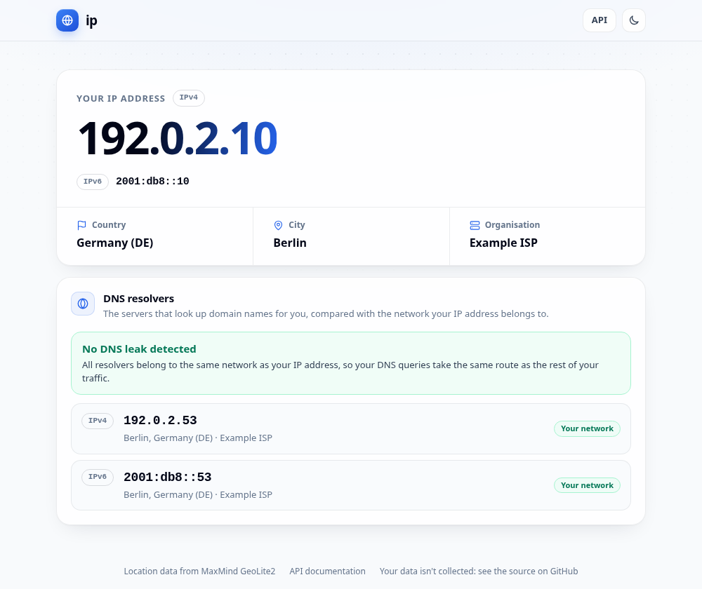
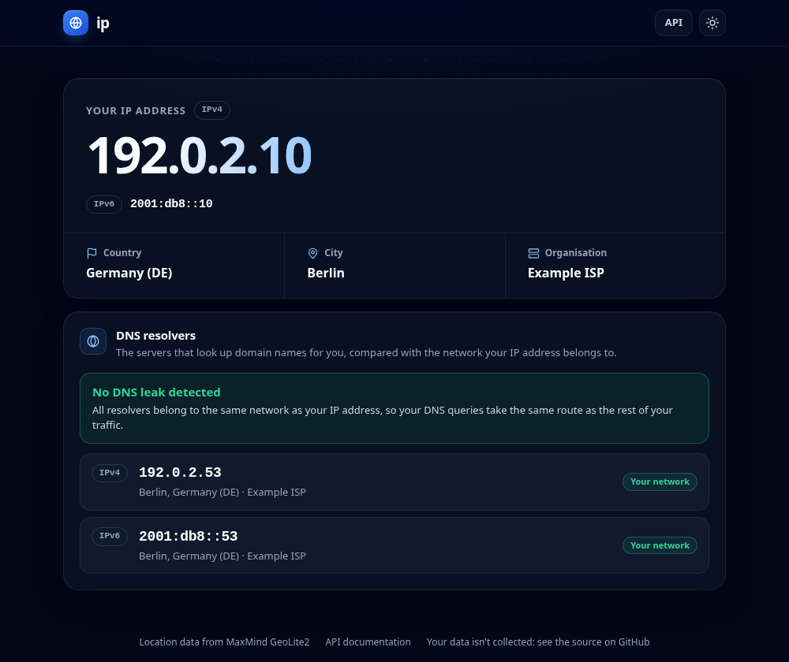

# ip


A small web page and JSON API that shows your public IPv4 and IPv6 addresses,
with the country, city and network (ASN) they belong to. It also has a DNS
leak test that shows which DNS resolvers look up names for you. It runs on
FastAPI behind Caddy and looks addresses up in local copies of the MaxMind
GeoLite2 databases.

| Light | Dark |
| --- | --- |
|  |  |

## Privacy

Your data isn't collected:

- The app looks addresses up in local GeoLite2 files and sends none to a
  third-party service.
- The app writes nothing to a database or to disk, and the API container runs
  with a read-only filesystem.
- The API runs uvicorn with `--no-access-log`, so it doesn't log requests. The
  errors it does log leave out the IP address.
- Caddy has no `log` directive, so it doesn't write access logs either.
- The home page uses no cookies, analytics or external scripts.
- The DNS leak test keeps resolver addresses in memory only, under a random
  test id that only your browser knows, and forgets them after 60 seconds.
  The DNS server doesn't log queries.

The interactive API docs at `/docs/` are FastAPI's default, which loads
Swagger UI from `cdn.jsdelivr.net` and its icon from `fastapi.tiangolo.com`,
so opening that page contacts those services.

## API

| Endpoint             | Returns                                                         |
| -------------------- | --------------------------------------------------------------- |
| `GET /`              | HTML page with your address and location                        |
| `GET /api/address/`  | Your IP address and its version, without a GeoIP lookup         |
| `GET /api/ip/`       | Location details for your IP address                            |
| `GET /api/ip/{ip}/`  | Location details for any IPv4 or IPv6 address                   |
| `GET /api/dns/{id}/` | DNS resolvers seen for a leak test id, and whether DNS leaks    |

```console
$ curl https://example.com/api/ip/8.8.8.8/
{"country":"United States","iso_code":"US","city":"Unknown","ip":"8.8.8.8","version":4,"org":"Google LLC"}
```

Errors return `{"detail": "..."}` with status 400 (not an IP address), 404 (not
in the database) or 500 (database missing or lookup failure).

## How both addresses are detected

A request reaches the server over IPv4 or IPv6, not both. To show the other
address, the page fetches `/api/address/` from two subdomains:

- `ipv4.<domain>` has only an A record, so the browser must connect over IPv4.
- `ipv6.<domain>` has only an AAAA record, so the browser must connect over IPv6.

If a fetch fails, the page shows that protocol as "Not detected".

## How the DNS leak test works

An NS record delegates `dns.<domain>` to a small DNS server that runs in the
API container. The page picks a random test id (32 hex digits) and makes the
browser look up `<id>-0.dns.<domain>` to `<id>-5.dns.<domain>`. Whichever
resolvers do those lookups for the browser have to ask this server. It saves
their addresses under the id and answers that the name doesn't exist
(NXDOMAIN), so the lookups fail and the browser makes no HTTP request. The page then
fetches `/api/dns/<id>/` to list the resolvers.

To tell whether DNS leaks, the API compares each resolver's network (its ASN
organisation) with the network of the address that asks for the result. Each
resolver gets `same_network`, and `leak` is `true` if any resolver is on
another network. Behind a VPN, that usually means DNS queries skip the tunnel.
It can also be a DNS provider you picked on purpose, such as a public resolver
or your VPN's own DNS on a different network, so the page calls it a possible
leak. Both fields are `null` when the API can't compare the networks, for
example when an address isn't in the GeoIP database.

Run the lookups yourself to test resolvers outside the browser:

```console
$ id=$(openssl rand -hex 16)
$ dig +short "$id-0.dns.example.com"
$ curl "https://example.com/api/dns/$id/"
```

## Deployment

1. Point DNS at the server: `<domain>` with A and AAAA records,
   `ipv4.<domain>` with only an A record, and `ipv6.<domain>` with only an
   AAAA record. For the DNS leak test, add A and AAAA records for
   `ns.<domain>`, and an NS record delegating `dns.<domain>` to
   `ns.<domain>`:

   ```text
   ns.example.com.   A    192.0.2.10
   ns.example.com.   AAAA 2001:db8::10
   dns.example.com.  NS   ns.example.com.
   ```

   Open port 53 for UDP and TCP. If the host runs systemd-resolved, its stub
   listener holds port 53. Set `DNSStubListener=no` in
   `/etc/systemd/resolved.conf` before starting the stack.
2. Download the GeoLite2 City and ASN databases from
   [MaxMind](https://dev.maxmind.com/geoip/geolite2-free-geolocation-data/)
   and save them as `city.mmdb` and `asn.mmdb` in the project root. Docker
   mounts them read-only into the container, so replacing them on the host is
   enough.
3. Copy `.env.example` to `.env` and set `DOMAIN`.
4. Start the stack:

   ```console
   docker compose up -d --build
   ```

Caddy gets TLS certificates for all three hostnames itself, with no setup.

## Development

[uv](https://docs.astral.sh/uv/) manages the dependencies and locks them in
`uv.lock`. The Docker image installs from the same file.

```console
uv sync
make run
```

The DNS leak test is off unless `DOMAIN` is set. Its DNS server listens on
port 5300, or on `DNS_PORT` if set. To try it locally:

```console
make run-dns
dig @::1 -p 5300 "$(openssl rand -hex 16)-0.dns.example.test"
```

| Command       | What it does                                             |
| ------------- | -------------------------------------------------------- |
| `make check`  | Lint and tests, the same as CI                           |
| `make test`   | Tests only                                               |
| `make lint`   | `ruff check` and `ruff format --check`                   |
| `make format` | Formats the code with ruff                               |
| `make audit`  | Checks the locked dependencies for known vulnerabilities |

The tests use a small fake GeoIP table, so they don't need the GeoLite2 files.

Pre-commit runs ruff and hadolint on each commit:

```console
uvx pre-commit install
```

## License

[MIT](LICENSE)
